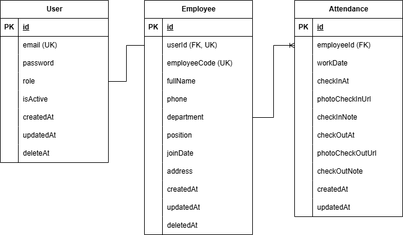

# Attendance Backend – Dexa Test System

Backend application built with **NestJS**, **Prisma ORM**, and **MySQL** for the WFH Employee Attendance Platform technical test.

---

## 🚀 Tech Stack

* **Framework:** [NestJS](https://nestjs.com/) (TypeScript)
* **Database & ORM:** MySQL & [Prisma ORM](https://www.prisma.io/)
* **Authentication:** JWT (JSON Web Tokens) & bcrypt
* **API Documentation:** Swagger / OpenAPI (\/docs\)

---

## 📊 Entity Relationship Diagram (ERD)

---

## 🛠️ Getting Started

### 1. Prerequisites
Pastikan Anda telah menginstal:
* Node.js (v18+ direkomendasikan)
* MySQL / XAMPP / Laragon
* Git

### 2. Installation

\\\ash
# 1. Clone the repository
git clone https://github.com/Salmanars/attendance-backend.git

# 2. Navigate to project directory
cd attendance-backend

# 3. Install dependencies
npm install
\\\`n
### 3. Environment Variables
Buat file \.env\ di root direktori proyek berdasarkan contoh berikut:

\\\env
# DATABASE
DATABASE_URL="mysql://root:@localhost:3306/attendance_db?allowPublicKeyRetrieval=true&ssl=false"
JWT_SECRET="CHANGETHISPLEASE"

# PORT
PORT=9000
\\\`n
### 4. Database Migration & Seed
\\\ash
# Generate Prisma Client (Prisma v7)
npx prisma generate

# Push schema to MySQL database
npx prisma db push

# Seed initial data (HRD & 15 Employees)
npx prisma db seed
\\\`n
### 5. Running the Application

\\\ash
# Development mode
npm run start:dev

# Production build
npm run build
npm run start:prod
\\\`n
Server akan berjalan di \http://localhost:9000\.

---

## 📖 API Documentation (Swagger)
Setelah server berjalan, Anda dapat mengakses dokumentasi endpoint secara lengkap melalui browser di:
👉 **\http://localhost:9000/docs\**
